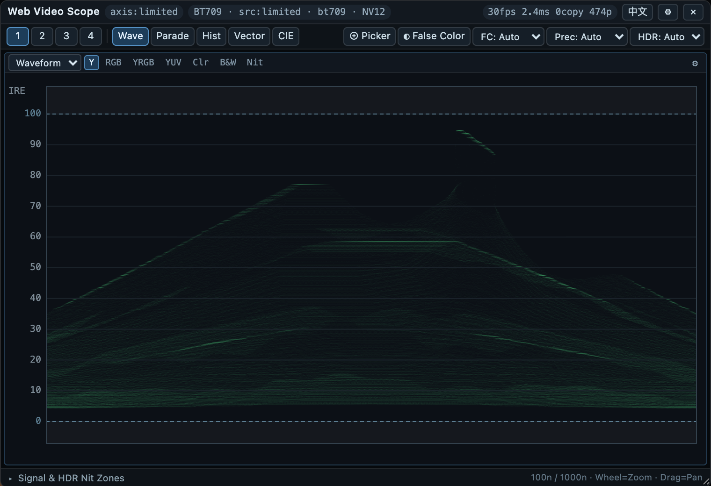
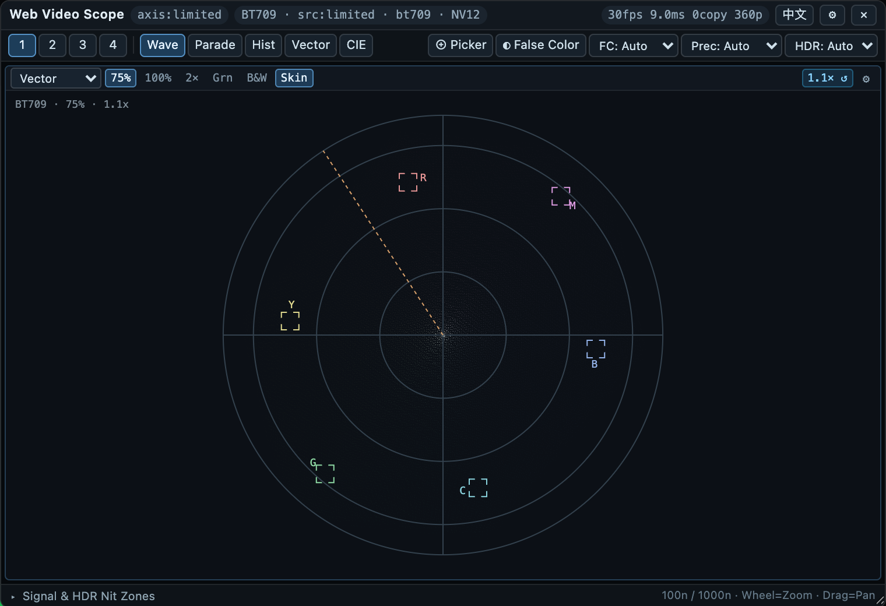
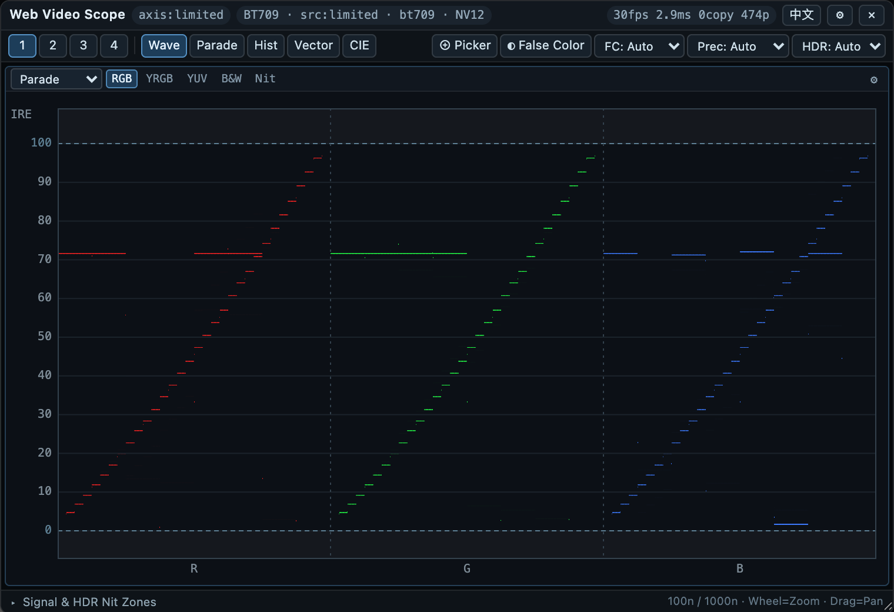
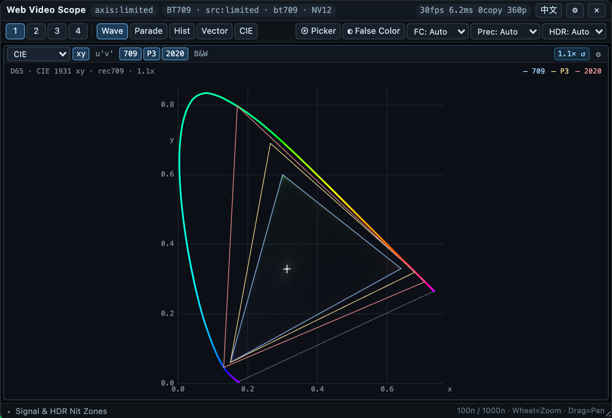
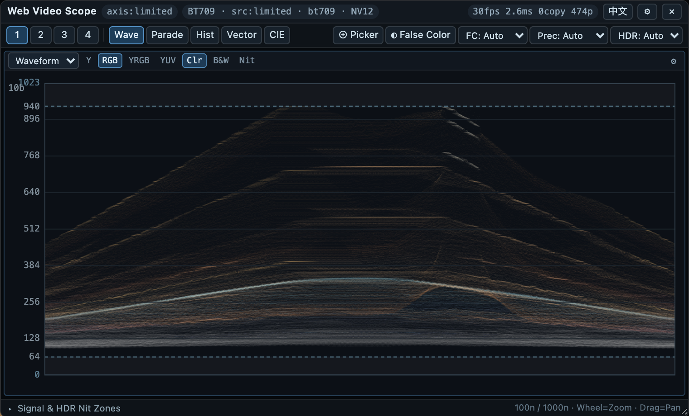
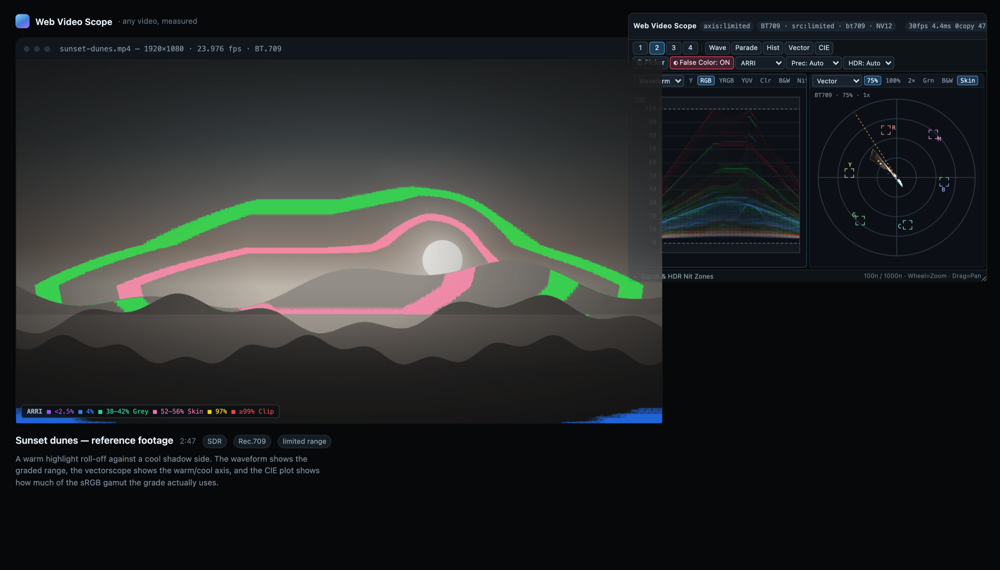

# Web Video Scope

**Broadcast-grade video scopes, overlaid on any video on the web.**

A Manifest V3 Chrome extension. Press `Alt+S` and a floating panel overlays a
waveform monitor, RGB parade, vectorscope and CIE chromaticity diagram on
whatever `<video>` element the page is playing — YouTube, Vimeo, a file://
clip, a canvas `captureStream`. It reads the video's real colour metadata and
draws the trace in code-value space, so legal black sits where a hardware
scope would put it.


```
pnpm install && pnpm build   →   chrome://extensions → Developer mode → Load unpacked → dist/
```

---

## What it measures

| Scope | What it tells you |
| --- | --- |
| **Waveform** | Exposure and black level per column of the picture. `Y` for luma alone, `RGB` overlaid to expose a colour cast, `YRGB` / `YUV`, or colourised by luminance. |
| **Parade** | The same signal split into R, G, B (or Y, U, V) side by side, so channels can be compared directly. |
| **Vectorscope** | Hue and saturation. 75% and 100% bar targets computed from the active matrix, plus the 123° skin-tone line. |
| **CIE 1931 / 1976** | Where the picture's colours sit inside the visible gamut, with Rec.709 / P3 / Rec.2020 triangles overlaid. |
| **Histogram** | Where the pixels pile up across the range, per channel or combined. |

<p align="center">
  
  
</p>
<p align="center">
  
  
</p>

## Five scales, one axis

`IRE`, `8-bit`, `10-bit`, `mV` and `nits` are five sets of labels on **one
underlying code-value axis**, so changing the scale never moves the trace — only
the numbers beside it. That is asserted by unit tests rather than assumed.

The 10-bit view below is the useful demonstration. A limited-range signal is
drawn where it actually lives: legal black at code 64, legal white at 940, with
the sub-black and super-white headroom still visible on either side. Nothing is
stretched to fill the box.

<p align="center">
  
</p>

## It reads the range instead of guessing it

`new VideoFrame(video).colorSpace` exposes `fullRange`, `matrix`, `primaries`
and `transfer` for the decoded frame. The status badge reports what was found:

```
axis:limited    BT709    src:limited · bt709 · NV12
```

If the metadata disagrees with the content — a limited-range signal labelled
full, or the reverse — a percentile heuristic over the frame's luma raises a
warning after 3 consecutive frames. The `range` selector overrides the verdict
by hand.

## False colour on the picture itself

ARRI, SmallHD, spectrum and HDR nit-zone ramps, drawn as an overlay on the video
rather than in a separate scope, so exposure problems show up where you are
actually looking.



---

## Performance

Smoothness is the first constraint; precision is a dial.

**Zero-copy upload.** Frames reach the GPU through `importExternalTexture`,
which hands over a handle to the decoder's own surface instead of copying
pixels. Measured at 1280×720 with `pnpm bench:upload` on this machine (Apple
GPU, Metal backend):

| Upload path | Median | p90 | Bytes moved per frame |
| --- | --- | --- | --- |
| `copyExternalImageToTexture` | 0.90 ms | 1.90 ms | 3.6 MB |
| `importExternalTexture` | **0.10 ms** | **0.20 ms** | **0** |

Roughly 9–10× less time in the upload step, and nothing copied. The copy path
stays as the fallback for cross-origin video, where import throws a
`SecurityError`.

**Fixed analysis resolution.** Each frame is downscaled once to a 640-pixel long
edge (640×360 for 16:9) and that single texture feeds every scope. Cost is
therefore independent of source resolution — the 4K version of a frame costs the
same as the 720p one.

**Frame-driven, not timer-driven.** `requestVideoFrameCallback` means the scopes
advance when the video does, and cost nothing while paused.

**Adaptive governor.** GPU time is measured per frame against a 4 ms budget.
Sustained overshoot walks down five tiers (60 fps / high → 15 fps / low); a
catastrophic frame skips two. Recovery needs a run of stable frames so the
display does not oscillate. The tier never changes *which* scopes you chose —
only their frame rate and analysis resolution. Click the badge to pin a tier.

In the captures above the panel reports **30 fps at ~3–6 ms** with all four
scopes open on a 1080p source, zero-copy upload confirmed.

All of it runs on WebGPU, which on macOS is Metal. There is no separate Metal
integration to add: the import, the compute gathers and the resolve passes are
already Metal work.

## Install

```bash
pnpm install
pnpm build          # writes dist/
```

Then in Chrome:

1. `chrome://extensions` → enable **Developer mode**
2. **Load unpacked** → select `dist/`
3. Open any page with a video and press **Alt+S**

Drag the header to move the panel, drag the bottom-right corner to resize, or
use `⧉` to detach it into an always-on-top window for a second monitor. Layout,
units, range override and quality tier persist across sessions. The panel keeps
working in fullscreen.

> Chrome 137+ removed the `--load-extension` switch, so loading the unpacked
> build is a UI step. `pnpm verify:manifest` checks everything about the package
> that can be verified without installing it.

## Development

```bash
pnpm test              # unit tests (vitest) — 276 tests
pnpm build             # production bundle
pnpm verify:manifest   # manifest, CSP and bundle integrity — 31 checks
pnpm verify:e2e        # injects the built content script on a live <video> — 24 checks
pnpm verify:ui         # panel layout, geometry, IRE axis — 15 checks
pnpm verify:scatter    # vectorscope + CIE point clouds, locus, fill — 12 checks
pnpm verify:cie        # CIE 1:1 axes, grid squareness, zoom, pickers — 12 checks
pnpm bench:upload      # zero-copy vs copying upload
pnpm capture:readme    # regenerate every image in this document
```

The browser suites drive real Chrome over WebGPU and assert on **measured
pixels** — "a 75% legal bar must read 75 ± 4 IRE", "the 3 button must yield three
sized panels" — not on screenshots.

`pnpm capture:readme` runs `scripts/capture-readme.mjs`. It opens
`docs/demo/index.html` (a synthetic watch page that renders known patterns
through `captureStream`), injects the built bundle, and measures every scope
canvas before saving the shot. A blank plot fails the capture instead of
shipping as a pretty picture of nothing.

Two notes on reading those suites, both learned the hard way:

- **A blank measurement is not always a blank scope.** A WebGPU canvas only
  holds pixels once it has been presented, and `createImageBitmap` can win that
  race and read transparent black. Every suite polls until a lit pixel appears.
- **A grey ramp cannot test a point-cloud scope.** Every pixel of a neutral ramp
  has one chromaticity, so a correct CIE plot shows a single dot — visually
  identical to a broken one. The scatter suites use colour bars and a hue ×
  saturation sweep, the only fixtures that fill the plot the way real footage
  does.

## Architecture

```
content script
├── video-detector   pick the main <video>, follow SPA navigation
├── frame-loop       rVFC, with a rAF watchdog for sources that never fire it
├── color-space      VideoFrame.colorSpace -> matrix / primaries / fullRange
├── scope-controller owns every GPU resource; one downscale shared by all scopes
└── ui/hud           shadow DOM panel (DOM + events only, no drawing)

core (pure, unit tested)
├── color            luma/chroma matrices, primaries, transfer functions, CIE locus
├── scale            code-space quantisation and unit ticks
├── range-detector   metadata + percentile heuristics
├── perf-governor    tier decisions
└── scopes/reference CPU kernels that serve as the GPU oracle

gpu
├── external-source          importExternalTexture wrapper (zero-copy upload)
├── downscale-external.wgsl  external texture -> fixed analysis texture
├── downscale.wgsl           copied source -> fixed analysis texture (fallback)
├── accumulate.wgsl          compute: pixel -> atomic density bins
└── resolve.wgsl             phosphor transfer + composite to a transparent canvas
```

The GPU density pass and its CPU reference implementation share one index
convention; the reference is the oracle the shader is checked against.

## Known limitations

1. **Display-referred by default.** Pixels arrive after the browser's colour
   management. For SDR Rec.709 that is exact — the range expansion inverts
   exactly. For PQ/HLG or non-Rec.709 primaries, switch to the raw-plane path.
2. **`nits` assumes PQ.** The axis is read as a PQ signal, exact for HDR. On SDR
   content it is a different set of reference ticks, labelled `PQ assumed`.
3. **Raw-plane mode has no per-channel RGB.** Only Y/U/V are available, so the
   RGB parade mirrors luma and says so.
4. **DRM video cannot be analysed.** EME-encrypted frames expose no pixels to
   the page. The panel says this rather than showing an empty scope.
5. **Cross-origin video without CORS needs `tabCapture`.** Opt-in, and requested
   only when you ask for it.
6. **The governor reduces frame rate under load**, never your layout. Pin a tier
   from the badge to opt out.

## Privacy

Everything runs locally. No network requests, no telemetry, and no frame is ever
written to disk — pixels are read in GPU memory, plotted, and discarded. Settings
live in `chrome.storage.local`. See
[docs/privacy-policy.md](docs/privacy-policy.md).

## Prior art

Resolve, Premiere and hardware scopes all do this properly. This exists because
none of them can measure what is already playing in a browser tab, and because
browser devtools have nothing to say about a picture's exposure.
