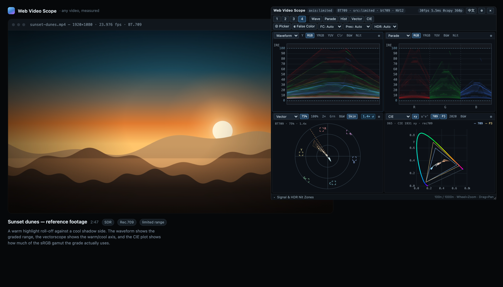
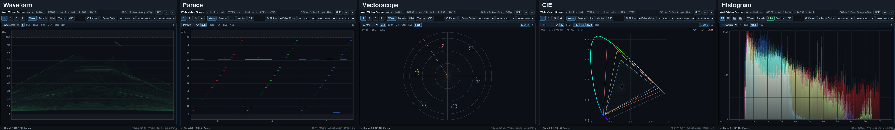
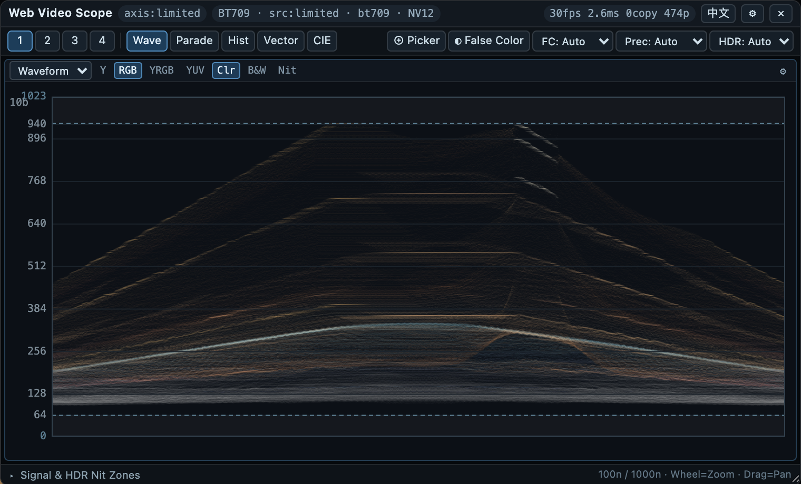
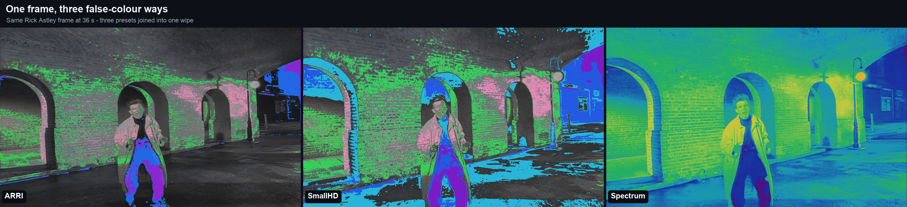

# Web Video Scope

> English → [README.md](README.md) · 简体中文（本文件）

**广播级示波器，直接叠在网页视频上。**

这是一个 Manifest V3 的 Chrome 扩展。按一下 `Alt+S`，悬浮面板就会把波形图、RGB 逐行图、矢量示波器和 CIE 色度图叠到页面里正在播放的 `<video>` 上——YouTube、Vimeo、本地 `file://` 视频，或者画布 `captureStream()` 出来的流都行。它读的是视频自带的色彩元数据，轨迹按码值空间绘制，所以合法黑会落在硬件示波器上该在的位置。



```
从 Releases 下载 web-video-scope-*.zip → 解压 →
chrome://extensions → 开发者模式 → 加载已解压的扩展 → 解压后的文件夹 → Alt+S
```

---

## 目录

- [它能测什么](#它能测什么)——五种示波器，以及怎么读
- [它怎么读信号](#它怎么读信号)——一根码值轴、范围检测、伪色
- [性能](#性能)——零拷贝上传、固定分析尺寸、自适应调速
- [安装与使用](#安装与使用)
- [开发与验证](#开发与验证)
- [架构](#架构)
- [已知限制](#已知限制)与[隐私](#隐私)
- [开源、致谢与许可](#开源致谢与许可)
- [先行作品](#先行作品)

---

## 它能测什么

| 示波器 | 看什么 |
| --- | --- |
| **波形（Waveform）** | 每一列画面的曝光和黑电平。`Y` 只看亮度，`RGB` 叠加能看出偏色，还有 `YRGB` / `YUV`，以及按亮度上色的模式。 |
| **逐行（Parade）** | 把同一路信号拆成 R、G、B（或 Y、U、V）并排摆着，方便直接对比通道。 |
| **矢量（Vectorscope）** | 色相和饱和度。75% / 100% 彩条目标按当前矩阵算出来，另外还有一条 123° 肤色线。 |
| **CIE 1931 / 1976** | 画面的颜色落在可见色域的什么位置，叠了 Rec.709 / P3 / Rec.2020 三角形。 |
| **直方图（Histogram）** | 像素在整个范围里怎么分布，可以分通道看，也可以合在一起看。 |

每个面板都能单独取色、缩放和调设置；拖动面板可以互换位置，工具栏里可以在单屏 / 双屏 / 三屏 / 四宫格之间切。

五种示波器并排，读的是真实测试素材——波形来自连续色调的场面，逐行来自 75% 彩条，矢量和 CIE 来自色相 × 饱和度扫描，直方图是 YRGB：



## 它怎么读信号

### 一根轴，五种刻度

`IRE`、`8-bit`、`10-bit`、`mV`、`nits` 只是**同一根码值轴**上的五套标签。换刻度不会让轨迹移动，变的只是旁边的数字——这一点有单元测试盯着，不是靠想当然。

下面这张 10 位图最能说明问题。有限范围的信号画在它真实所在的位置：合法黑在码值 64，合法白在 940，黑下和白上的余量都还看得见。没有任何拉伸去填满画面。



### 范围靠读，不靠猜

`new VideoFrame(video).colorSpace` 会把解码帧的 `fullRange`、`matrix`、`primaries`、`transfer` 交出来。状态徽章显示读到的结果：

```
axis:limited    BT709    src:limited · bt709 · NV12
```

如果元数据和画面对不上——有限范围的信号被标成全范围，或者反过来——程序会在连续 3 帧后用亮度百分位启发式算法发出提醒。也可以直接用 `range` 选择器手动覆盖。

### 伪色直接画在画面上

ARRI、SmallHD 和光谱三种伪色渐变是直接叠在视频上的，不在单独的示波器里，所以曝光问题会显示在你要看的地方。下面这条把**同一帧**（上面视频第 36 秒的 Rick Astley）依次擦过三种预设，唯一变的就是伪色映射：



---

## 性能

流畅是第一约束，精度是可以调的旋钮。

**零拷贝上传。** 帧通过 `importExternalTexture` 送到 GPU，交出去的是解码器自有表面的句柄，不复制像素。在本机（Apple GPU，Metal 后端）用 `pnpm bench:upload` 于 1280×720 测得：

| 上传路径 | 中位数 | p90 | 每帧搬移字节 |
| --- | --- | --- | --- |
| `copyExternalImageToTexture` | 0.90 ms | 1.90 ms | 3.6 MB |
| `importExternalTexture` | **0.10 ms** | **0.20 ms** | **0** |

上传这一步快了大约 9–10 倍，字节一个不搬。复制路径仍然留着做后备，供跨域视频使用（这时 import 会抛 `SecurityError`）。

**固定分析分辨率。** 每帧先降采样到长边 640 像素（16:9 就是 640×360），所有示波器共用这一张纹理。所以开销跟源分辨率无关——同一帧的 4K 版和 720p 版成本一样。

**跟着帧走，不跟着定时器走。** `requestVideoFrameCallback` 让示波器随视频推进，暂停时零开销。

**自适应调速。** 每帧都按 4 ms 预算测 GPU 耗时。持续超预算就逐级下调五档（60 fps / high → 15 fps / low）；某一帧严重超时跳两级。恢复要连续稳定几帧，免得显示来回跳。档位只改帧率和分析分辨率，**不会动**你选的示波器。点徽章可以把档位钉住。

上面的截图里，1080p 源四示波器全开，面板报的是 **30 fps、约 3–6 ms**，零拷贝上传已确认。

这些全跑在 WebGPU 上，在 macOS 上就是 Metal。不需要另外写 Metal 代码：导入、计算 gather、resolve 通道本身已经是 Metal 的活。

## 安装与使用

### 最简单：下载打包好的 release

从 [Releases 页面](https://github.com/bobhhu97/web-video-scope/releases) 下载最新的
`web-video-scope-<版本>.zip`，解压后在 Chrome 里：

1. 打开 `chrome://extensions` → 打开**开发者模式**
2. 点**加载已解压的扩展** → 选解压出来的文件夹（就是含 `manifest.json` 的那一层）
3. 打开任意带视频的页面，按 **Alt+S**

不需要 `pnpm`、Node 或任何构建步骤——这个 ZIP 就是完整的扩展。
它没有上架 Chrome 网上应用店，所以 Chrome 会显示开发者模式扩展的警告，这是未打包加载的正常现象。

### 从源码构建

```bash
pnpm install
pnpm build          # 输出到 dist/
pnpm package        # 输出到 release/web-video-scope-<版本>.zip
```

然后按上面 1–3 步在 Chrome 里加载 `dist/` 即可。

拖标题栏移动面板，拖右下角改大小，或者点 `⧉` 把它拆成置顶窗口扔到第二块屏幕。布局、单位、范围覆盖和质量档位都会跨会话记住。全屏下也能用。

> Chrome 137+ 去掉了 `--load-extension` 开关，所以加载未打包的构建只能在界面里点。`pnpm verify:manifest` 会检查这个包在不安装的前提下能查的所有东西。

## 开发与验证

```bash
pnpm test              # 单元测试（vitest）——290 项
pnpm build             # 生产构建
pnpm verify:manifest   # manifest、CSP 与包完整性——31 项检查
pnpm verify:e2e        # 在真实 <video> 上注入构建后的内容脚本——24 项检查
pnpm verify:ui         # 面板布局、几何、IRE 轴——15 项检查
pnpm verify:scatter    # 矢量与 CIE 点云、轨迹、填充——12 项检查
pnpm verify:cie        # CIE 1:1 轴、网格方正度、缩放、拾色器——12 项检查
pnpm bench:upload      # 零拷贝与复制上传对比
pnpm capture:readme    # 重新生成本文档里的每张图
```

浏览器测试套件会驱动真实 Chrome 跑 WebGPU，并且对**实际测出来的像素**下断言——"75% 合法彩条必须读到 75 ± 4 IRE"、"按 3 应该出三个尺寸合适的面板"——不是拿截图去比。

`pnpm capture:readme` 跑的是 `scripts/capture-readme.mjs`。它打开 `docs/demo/index.html`（一个人造的观看页，用 `captureStream` 渲染已知图案），注入构建好的 bundle，存图之前会先量每一个示波器画布。空白图表会让捕获失败，不会当成一张好看的空图发出去。

关于怎么看这些套件，有两条踩坑换来的经验：

- **量到空白，不一定是示波器空了。** WebGPU 画布只有呈现之后才有像素，而 `createImageBitmap` 可能抢在前面读到透明黑。每个套件都会轮询到有亮像素为止。
- **灰色斜坡测不了点云示波器。** 中性斜坡每个像素的色度都一样，正确的 CIE 图也就只有一个点——看上去跟坏了一模一样。散点套件用的是彩条和色相 × 饱和度扫描，只有这种夹具能像真实素材那样把图填满。

## 架构

```
内容脚本
├── video-detector     挑出主 <video>，跟着 SPA 导航走
├── frame-loop         rVFC，对不触发它的源用 rAF 看门狗兜底
├── color-space        VideoFrame.colorSpace -> matrix / primaries / fullRange
├── scope-controller   管所有 GPU 资源；一次降采样供全部示波器共享
└── ui/hud             shadow DOM 面板（只管 DOM 和事件，不画图）

core（纯逻辑，有单元测试）
├── color             亮度/色度矩阵、原色、传递函数、CIE 轨迹
├── scale             码空间量化与刻度
├── range-detector    元数据 + 百分位启发式
├── perf-governor     档位决策
└── scopes/reference  作为 GPU 判据的 CPU 内核

gpu
├── external-source          importExternalTexture 包装（零拷贝上传）
├── downscale-external.wgsl  external texture -> 固定分析纹理
├── downscale.wgsl           复制源 -> 固定分析纹理（后备）
├── accumulate.wgsl          compute：像素 -> 原子密度桶
└── resolve.wgsl             荧光粉传递 + 合成到透明画布
```

GPU 密度通道和它的 CPU 参考实现共用同一套索引约定；参考实现就是拿来检验着色器的判据。

## 已知限制

1. **默认是显示参考（display-referred）。** 像素是过了浏览器色彩管理才到手的。对 SDR Rec.709 是准的——范围扩展可逆得很干净。PQ/HLG 或者非 Rec.709 原色，请切到原始平面（raw-plane）路径。
2. **`nits` 按 PQ 来读。** 这根轴按 PQ 信号处理，对 HDR 是准的。放到 SDR 内容上就是另一套参考刻度，会标成 `PQ assumed`。
3. **原始平面模式没有逐通道 RGB。** 只有 Y/U/V，所以 RGB 逐行会镜像亮度，并且明确标注。
4. **DRM 视频分析不了。** EME 加密帧不向页面暴露像素。面板会如实说明，不会画个空示波器糊弄。
5. **没有 CORS 的跨域视频需要 `tabCapture`。** 这是可选功能，只有你主动要点才会申请。
6. **负载高了调速器会降帧率**，但绝不会动你的布局。点徽章钉住档位就能退出调速。

## 隐私

全部在本地跑。不发网络请求、不上传遥测、任何帧都不落盘——像素在 GPU 内存里读、画、丢。设置存在 `chrome.storage.local`。详见 [docs/privacy-policy.md](docs/privacy-policy.md)。

## 参与贡献

欢迎贡献——代码、文档、bug 报告和测试素材都算。开发环境的搭法、PR 流程和项目的基本原则见 [CONTRIBUTING.md](CONTRIBUTING.md)。参与前请先读 [CODE_OF_CONDUCT.md](CODE_OF_CONDUCT.md)。安全问题请按 [SECURITY.md](SECURITY.md) 私下报告。

## 开源、致谢与许可

### 本项目的许可

Web Video Scope 用 **MIT 许可证**发布，全文见 [LICENSE](LICENSE)。版权所有 © 2026 Web Video Scope 贡献者。

### 用到的开源项目

包里不带任何运行时依赖——构建出来的扩展是自包含的。下面这些项目用在构建/测试阶段，或者提供了参考数据，感谢它们的作者：

| 项目 | 许可证 | 用途 |
| --- | --- | --- |
| [TypeScript](https://www.typescriptlang.org/) | Apache-2.0 | 语言与编译器 |
| [Vite](https://vitejs.dev/) | MIT | 构建工具 |
| [Vitest](https://vitest.dev/) | MIT | 单元测试 |
| [jsdom](https://github.com/jsdom/jsdom) | MIT | 测试里模拟 DOM |
| [Puppeteer](https://pptr.dev/)（`puppeteer-core`） | Apache-2.0 | 截 README 的图 |
| [`@webgpu/types`](https://github.com/gpuweb/types) | BSD-3-Clause | WebGPU 类型定义 |
| [`@types/chrome`](https://github.com/DefinitelyTyped/DefinitelyTyped) / [`@types/jsdom`](https://github.com/DefinitelyTyped/DefinitelyTyped) | MIT | Chrome / jsdom 类型定义 |
| [colour-science](https://www.colour-science.org/) | BSD-3-Clause | 生成 `src/core/color/locus-data.ts` 里的 CIE 标准观察者轨迹数据（只派生了数据，没有复制代码） |

`pnpm-lock.yaml` 里解析出来的构建工具传递依赖（esbuild、rollup、chai 和 Vitest 生态）同样只在开发期使用，各自保留自己的许可证。

示波器的行为还参考了公开标准与惯例——ITU-R BT.2408（203 尼特 SDR 参考白）、Rec.709 / P3 / Rec.2020、SMPTE/EBU 彩条目标——UX 上借鉴了 DaVinci Resolve。这些是规范和设计参考，不是抄来的代码。

演示画面取自 [youtube.com/watch?v=dQw4w9WgXcQ](https://www.youtube.com/watch?v=dQw4w9WgXcQ)，版权归各自权利人所有。

## 先行作品

Resolve、Premiere 和硬件示波器这些事都做得很好。这个项目存在的理由只有一个：它们都没法测浏览器标签页里正在播的画面，而浏览器开发者工具对一张图像的曝光也无话可说。
